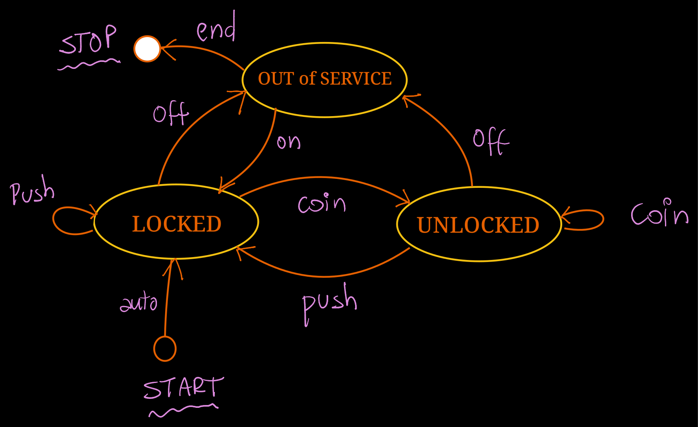

# Turnstile Simulator

## Intro

This project simulates a turnstile.

The turnstile is modelled as a Finite State Machine (FSM).
The goal of this project is to briefly introduce classes, modelling with FSM
and the Game Loop design pattern to run the simulation.

## The Turnstile FSM

Here is the FMS that represents the expected turnstile behavior.

---

&copy; DIMAp/UFRN 2025-2026.
